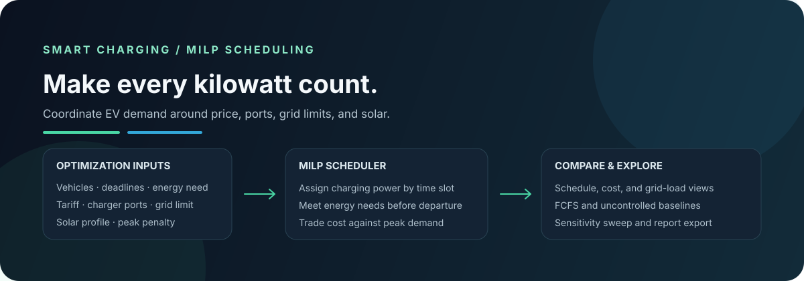

<div align="center">

# Intelligent EV Charging Optimization

### A mixed-integer optimization study of charging cost, station capacity, and solar use

[](https://www.python.org/)
[](https://streamlit.io/)
[](https://developers.google.com/optimization)



**Explore the schedule, inspect the trade-offs, and change the scenario in the dashboard.**

</div>

---

## What this project does

This project formulates a charging station as a mixed-integer linear program (MILP). It chooses how much power each available EV receives in each time slot while meeting charging requirements and respecting charger-port and grid limits. The objective combines time-of-use electricity cost with a configurable peak-demand penalty. Solar generation can offset grid electricity.

The app also compares optimized charging with simple uncontrolled and first-come-first-served (FCFS) baselines, runs a parameter sensitivity sweep, and generates a Markdown research report.

## Run locally

```bash
git clone https://github.com/Naksh-IIITB/ev-charging-optimization.git
cd ev-charging-optimization
python3 -m pip install -r requirements.txt
python3 -m streamlit run app.py
```

For a command-line run that writes the schedule and report to `results/`:

```bash
python3 main.py
```

Run the tests with:

```bash
python3 -m unittest discover -s tests -v
```

## Dashboard controls

The sidebar exposes fleet size and random seed, scheduling horizon and time-step, port and grid capacity, peak-demand penalty, time-of-use price scale, solar scale, battery-capacity range, initial and target state-of-charge ranges, EV charging-power range, and charging efficiency. The results are organized into Optimization, Sensitivity analysis, and Academic report tabs.

## Model

For EV \(i\) and time slot \(t\), let \(p_{it}\) be assigned charging power and \(z_{it}\) indicate whether a port is assigned. The model minimizes:

```text
sum_t(price_t * grid_t * slot_duration) + peak_penalty * peak_grid_demand
```

Subject to:

- each EV receives its requested energy by departure, accounting for charging efficiency;
- charging power is bounded by the EV's maximum and its port assignment;
- no more than the configured number of ports are in use in a time slot;
- EVs may charge only while they are connected;
- grid draw stays within the configured capacity;
- solar usage does not exceed either solar generation or station load.

The implementation uses OR-Tools' SCIP MILP backend.

## Data and assumptions

The default experiment is **synthetic** and reproducible by seed. It is intended for demonstrating and testing the optimization model, not as measured station performance.

The optional CSV uploader expects normalized EV-session data with these columns:

| Column | Meaning |
| --- | --- |
| `ev_id` | Unique session or vehicle identifier |
| `arrival_hour` | Connection time as decimal hour |
| `departure_hour` | Required departure time as decimal hour |
| `initial_soc` | Initial state of charge, percent |
| `target_soc` | Requested target state of charge, percent |
| `battery_capacity_kwh` | Battery capacity in kWh |
| `max_power_kw` | Maximum charging power in kW |
| `efficiency` | Optional charging efficiency; defaults to 0.92 |

ACN-Data session records do not directly provide every battery capacity and state-of-charge value required by this model. Raw ACN data therefore needs preprocessing and clearly documented assumptions before it can be used here; uploading an ACN file as-is is not claimed to work.

## Project layout

```text
.
├── app.py
├── main.py
├── requirements.txt
├── docs/
│   └── overview.svg
├── results/
│   ├── academic_report.md
│   └── optimized_schedule.csv
├── src/
│   ├── baselines.py
│   ├── dashboard.py
│   ├── evaluation.py
│   ├── optimization.py
│   ├── reporting.py
│   └── scenario.py
└── tests/
    └── test_optimization.py
```

## Limitations

- The baseline schedulers are simple heuristic comparators, not optimal reference models.
- The sensitivity results are deterministic parameter sweeps, not a statistical uncertainty study.
- The model assumes constant per-EV charging power limits and slot-level availability.
- The generated prices and solar profile are illustrative and should be replaced with local tariff and generation data for applied studies.

## License

No license has been selected for this repository. All rights remain with the author; reuse is not granted by default.
